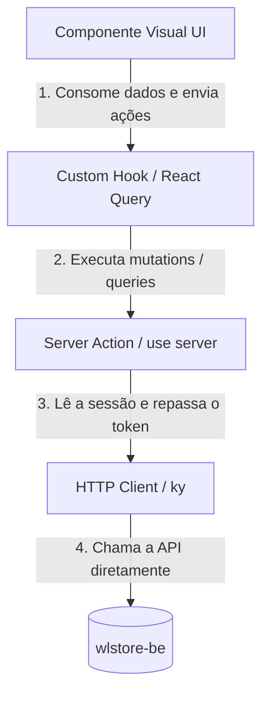

# Padrões de Desenvolvimento e Arquitetura de Features (Clean Architecture)

Este documento define as diretrizes arquiteturais e padrões de código para o desenvolvimento de novas features em projetos Next.js. O objetivo é manter o código profissional, altamente modular, extensível e com responsabilidades bem definidas, separando totalmente a lógica de negócio e estados de sincronização dos componentes visuais.

---

## 1. Estrutura de Diretórios de uma Feature

Cada feature deve ser auto-contida dentro de seu próprio diretório `src/features/<FeatureName>`. A estrutura interna deve seguir estritamente a divisão abaixo:

```text
src/features/<FeatureName>/
├── actions/             # Server Actions (Mutations & Data-fetching de servidor)
│   ├── get-<items>-action.ts
│   ├── get-<item>-action.ts
│   ├── post-<item>-action.ts
│   ├── put-<item>-action.ts
│   └── delete-<item>-action.ts
├── components/          # Componentes visuais de UI (Dumb e Smart components)
│      └── <FeatureName>/
│       ├── index.tsx    # Componente principal (Controller/Orchestrator da Feature)
│       └── <FeatureName>.test.tsx
├── enums/               # Enums TypeScript locais da feature
│   └── index.ts
├── hooks/               # Custom Hooks (Lógica de formulários, query strings e React Query)
│   ├── use-get-<items>.ts
│   ├── use-get-<item>.ts
│   ├── use-post-<item>.ts
│   ├── use-put-<item>.ts
│   └── use-delete-<item>.ts
├── http/                # Integrações brutas de API (instância ky de src/config/api.ts)
│   ├── get-<items>.ts
│   ├── get-<item>.ts
│   ├── post-<item>.ts
│   ├── put-<item>.ts
│   └── delete-<item>.ts
├── schemas/             # Validações Zod (separados por arquivo/tipo de dados)
│   ├── get-<item>.ts
│   ├── post-<item>.ts
│   ├── put-<item>.ts
│   └── delete-<item>.ts
└── types/               # Tipos e Interfaces globais da feature (arquivo único, não um barrel de schemas/)
    └── index.ts
```

> **Sem barrel exports**: cada arquivo em `schemas/` deve ser importado diretamente pelo caminho completo (ex: `from "../schemas/brands-query-params"`), nunca através de um `index.ts` que reexporta o diretório inteiro. Barrels escondem de onde cada tipo realmente vem, dificultam a árvore de dependências e podem causar carregamento circular de módulos em testes. `types/index.ts` é uma exceção deliberada: não reexporta `schemas/`, é o único arquivo onde interfaces/tipos puros da feature são definidos diretamente.

---

## 2. Responsabilidade das Camadas e Fluxo de Dados

O fluxo de dados da feature segue uma hierarquia unidirecional e em camadas bem definidas:



### A. Cliente HTTP e autenticação (`src/config/api.ts`)

Uma **única instância `ky`** apontando direto para o backend. Sem proxy, sem
Route Handler intermediário, sem BFF.

```typescript
const API_URL = process.env.NEXT_PUBLIC_API_URL ?? 'http://localhost:3333';

export function authHeaders(accessToken: string): Record<string, string> {
  return { Authorization: `Bearer ${accessToken}` };
}

export const api: KyInstance = ky.extend({
  prefix: API_URL,
  timeout: 15_000,
  retry: 0,
  cache: 'no-store',
  headers: { Accept: 'application/json' },
  hooks: {
    // Troca a mensagem crua do ky pela mensagem que a API devolve no corpo.
    beforeError: [
      /* … */
    ],
  },
});
```

**Regras invioláveis:**

1. **Nunca criar um Route Handler proxy** (`app/api/**`) para repassar chamadas
   à API de negócio. Isso adiciona um salto de rede inútil, duplica tratamento
   de erro e quebra em Server Actions (`fetch` no server não tem base URL
   implícita como no browser — um caminho relativo tipo `/api/backend` não
   resolve). Server Actions rodam no mesmo processo Node e falam com o backend
   diretamente.
2. **Nunca instanciar `ky`/`fetch` avulso dentro de uma feature.** Toda chamada
   passa pela instância de `src/config/api.ts`, para herdar timeout, tratamento
   de erro e headers padrão.
3. **A instância não injeta auth.** Endpoints públicos (login, register) a usam
   direto; endpoints autenticados recebem `headers: authHeaders(accessToken)`.
4. **O tenant nunca vai no request.** O wlstore-be sempre o extrai do próprio
   token (`TenantContextGuard`) — nunca do body, da query ou de um header.

### B. HTTP (`http/`)

Realiza as chamadas de rede cruas. **Camada pura**: não lê cookies, não acessa
`next/headers`, não valida — recebe tudo por parâmetro e devolve a resposta
tipada. É isso que a mantém testável sem mockar o runtime do Next.

- **Regra**: o `accessToken` chega como **parâmetro**, nunca lido de dentro.
- **Exemplo**:

  ```typescript
  import { api, authHeaders } from '@/config/api';
  import type { PaginatedResponse, Patient } from '../types';
  import type { PatientsQueryParams } from '../schemas/patients-query-params';

  export async function getPatients(
    params: PatientsQueryParams,
    accessToken: string,
  ): Promise<PaginatedResponse<Patient>> {
    return api
      .get('patients', {
        headers: authHeaders(accessToken),
        searchParams: {
          page: params.page,
          perPage: params.perPage,
          ...(params.search ? { search: params.search } : {}),
        },
      })
      .json<PaginatedResponse<Patient>>();
  }
  ```

### C. Server Actions (`actions/`)

Funções assíncronas rodando estritamente no servidor Next.js (`"use server"`).

- **Regra**: são a ponte segura. É **aqui** — e só aqui — que a sessão é lida
  (`getServerSession()`), o input é validado com Zod e o token é repassado para
  a camada `http/`. Sempre retornam `{ success, message, data? }`, nunca lançam.
- **Exemplo**:

  ```typescript
  'use server';

  import { getServerSession, SESSION_EXPIRED_MESSAGE } from '@/lib/session';
  import { getPatients } from '../http/get-patients';
  import type { PatientsQueryParams } from '../schemas/patients-query-params';
  import type { ActionResult, PaginatedResponse, Patient } from '../types';

  export async function getPatientsAction(
    params: PatientsQueryParams,
  ): Promise<ActionResult<PaginatedResponse<Patient>>> {
    const session = await getServerSession();
    if (!session) return { success: false, message: SESSION_EXPIRED_MESSAGE };

    try {
      const data = await getPatients(params, session.accessToken);
      return { success: true, message: 'Sucesso', data };
    } catch (error) {
      console.error('[Get Patients Action Error]', error);
      return {
        success: false,
        message: error instanceof Error ? error.message : 'Erro inesperado',
      };
    }
  }
  ```

#### Ações restritas por papel (ADMIN)

Quando o endpoint no wlstore-be usa `@Roles(Role.ADMIN)` (ex: escrita em
`professionals`, `procedures`, tudo em `users`), a proteção vive em **três
camadas** — nenhuma substitui a outra:

1. **UI** (`useIsAdmin()` de `src/components/providers/session-provider.tsx`):
   esconde botões e a coluna de ações. É conveniência visual, não segurança.
2. **Server Action** (`requireAdmin()` de `src/lib/session.ts`): barra antes
   de gastar a chamada HTTP e devolve mensagem em português.
3. **Backend**: `@Roles(ADMIN)` é a autoridade final — responde 403 mesmo se
   as duas camadas acima forem contornadas.

```typescript
'use server';

import {
  FORBIDDEN_MESSAGE,
  requireAdmin,
  SESSION_EXPIRED_MESSAGE,
} from '@/lib/session';

export async function postProfessionalAction(input: CreateProfessionalSchema) {
  const auth = await requireAdmin();
  if (!auth.ok) {
    return {
      success: false,
      message:
        auth.reason === 'forbidden'
          ? FORBIDDEN_MESSAGE
          : SESSION_EXPIRED_MESSAGE,
    };
  }
  // … valida com Zod e chama a camada http/ com auth.session.accessToken
}
```

> Leitura costuma ser liberada para qualquer papel (o backend não põe
> `@Roles` nos `GET` de `professionals`/`procedures`). Confira o controller
> antes de assumir: restringir demais esconde dado que o STAFF precisa ver.

### D. Custom Hooks & React Query (`hooks/`)

A camada de controle de estado e sincronização assíncrona.

- **Regra**: Todos os fetches de dados assíncronos e mutations devem ser encapsulados em hooks que utilizam `@tanstack/react-query` (`useQuery`, `useMutation`).
- **Sincronização de Filtros e URL (Debounce)**: Lógicas de filtros de busca com debounce que escrevem parâmetros na URL (`searchParams`) devem ser isoladas em um hook próprio de estado de filtros.
- **Exemplo de Hook de React Query (`use-patients.ts`, real do projeto)**:

  ```typescript
  'use client';

  import { useQuery } from '@tanstack/react-query';
  import { getPatientsAction } from '../actions/get-patients-action';
  import type { PatientsQueryParams } from '../schemas/patients-query-params';

  export const PATIENTS_QUERY_KEY = ['patients'] as const;

  export function usePatients(params: PatientsQueryParams) {
    const { data, isLoading, isFetching, error, refetch } = useQuery({
      queryKey: [...PATIENTS_QUERY_KEY, params],
      queryFn: async () => {
        const result = await getPatientsAction(params);
        if (!result.success) {
          throw new Error(result.message);
        }
        return result.data;
      },
      placeholderData: (previousData) => previousData,
    });

    return {
      patients: data?.data ?? [],
      meta: data?.meta,
      isLoading,
      isFetching,
      error,
      refetch,
    };
  }
  ```

  **Sessão expirada não precisa de tratamento manual em cada hook.** Uma
  tentativa anterior chamava `useSessionExpiredGuard(error)` em todo hook de
  `useQuery` — cobria leituras, mas nenhuma das ~20 mutations do projeto
  tinha a mesma checagem, então uma sessão morta numa ação de escrita (criar
  paciente, trocar senha) só mostrava o snackbar de erro genérico e nunca
  deslogava. Isso está resolvido de forma centralizada: `QueryProvider`
  (`src/components/providers/query-provider.tsx`) configura `queryCache` e
  `mutationCache` com um `onError` que detecta a mensagem estável
  `SESSION_EXPIRED_MESSAGE` (`src/lib/session-messages.ts`) em **qualquer**
  query ou mutation do app, chama `logoutAction()` e redireciona pra
  `/login` sozinho. Não precisa (e não deve) adicionar nada disso em hooks
  novos — o `error` do exemplo acima já é observado automaticamente pelo
  `QueryClient` global.

  Mutations seguem o mesmo padrão, mas usando `useMutation` + o hook global
  de Snackbar (ver seção 3) e invalidando a query da listagem no sucesso:

  ```typescript
  'use client';

  import { useMutation, useQueryClient } from '@tanstack/react-query';
  import { useSnackbar } from '@/components/providers/snackbar-provider';
  import { postPatientAction } from '../actions/post-patient-action';
  import { PATIENTS_QUERY_KEY } from './use-patients';
  import type { CreatePatientSchema } from '../schemas/patient';

  export function useCreatePatient() {
    const queryClient = useQueryClient();
    const snackbar = useSnackbar();

    return useMutation({
      mutationFn: async (input: CreatePatientSchema) => {
        const result = await postPatientAction(input);
        if (!result.success) throw new Error(result.message);
        return result.data;
      },
      onSuccess: () => {
        snackbar.showSuccess('Paciente cadastrado.');
        queryClient.invalidateQueries({ queryKey: PATIENTS_QUERY_KEY });
      },
      onError: (error) => snackbar.showError(error.message),
    });
  }
  ```

  **Consumindo a mutation num dialog**: `mutateAsync()` (diferente de
  `mutate()`) **relança o erro** depois de rodar `onError` — é assim que o
  React Query permite tratamento local além do snackbar global. Todo
  `await xyz.mutateAsync(...)` num `onSubmit`/`handleConfirm` precisa estar
  dentro de um `try/catch`, mesmo que o `catch` fique vazio (o snackbar já
  cobre a mensagem via `onError` do hook). Sem isso, o primeiro erro real
  (ex.: uma validação de negócio que o schema Zod não cobre, tipo conflito
  de horário) relança pelo `await` desprotegido, vira uma exceção não
  capturada, e derruba a página inteira (ver `docs/ROADMAP.md`, seção
  "Armadilha resolvida: `mutateAsync` sem `try/catch` derrubava a página",
  onde isso aconteceu de verdade em 9 dialogs antes de ser corrigido):

  ```typescript
  const onSubmit = handleSubmit(async (values) => {
    try {
      await createPatient.mutateAsync(values);
      onOpenChange(false); // só fecha o dialog se a mutation teve sucesso
    } catch {
      // Erro já exibido pelo snackbar via onError do hook — dialog
      // continua aberto para o usuário corrigir.
    }
  });
  ```

  Se o dialog não precisa aguardar o resultado antes de fechar (ex.: uma
  transição de status disparada direto no menu de ações de uma tabela, sem
  dialog de confirmação), prefira `.mutate()` (fire-and-forget) — ele nunca
  relança, então não precisa de `try/catch`.

- **Exemplo de Hook de Filtros e Query Strings (`use-patients-filters-state.ts`, real do projeto)**:

  > A API do wlstore-be é 1-indexed (`page: 1` é a primeira página) — não
  > 0-indexed como muitos componentes de tabela assumem por padrão. O hook
  > de filtros usa a convenção da API; é o wrapper do DataGrid
  > (`src/components/data-grid/`) quem converte para o índice 0 que o MUI
  > X DataGrid espera, não o contrário.

  ```typescript
  'use client';

  import { useCallback, useEffect } from 'react';
  import { usePathname, useRouter, useSearchParams } from 'next/navigation';
  import { useForm, useWatch } from 'react-hook-form';

  export function usePatientsFiltersState() {
    const router = useRouter();
    const pathname = usePathname();
    const searchParams = useSearchParams();

    const page = Number(searchParams.get('page') ?? '1');
    const perPage = Number(searchParams.get('perPage') ?? '10');
    const urlSearch = searchParams.get('search') ?? '';

    const { control, reset } = useForm({
      defaultValues: { search: urlSearch },
    });
    const watchedSearch = useWatch({ control, name: 'search' });

    const updateParams = useCallback(
      (updates: Record<string, string | null>) => {
        const params = new URLSearchParams(searchParams.toString());
        Object.entries(updates).forEach(([key, value]) => {
          if (value === null || value === '') params.delete(key);
          else params.set(key, value);
        });
        router.replace(`${pathname}?${params.toString()}`);
      },
      [searchParams, pathname, router],
    );

    useEffect(() => {
      const handler = setTimeout(() => {
        if (watchedSearch !== urlSearch) {
          updateParams({ search: watchedSearch ?? '', page: '1' });
        }
      }, 500);
      return () => clearTimeout(handler);
    }, [watchedSearch, urlSearch, updateParams]);

    return {
      control,
      page,
      perPage,
      urlSearch,
      updateParams,
      clearFilters: () => {
        reset({ search: '' });
        updateParams({ search: null, page: '1' });
      },
    };
  }
  ```

### E. Componentes (`components/`)

A camada estritamente visual (apresentação).

- **Regra**: Devem apenas exibir informações e receber interações do usuário. Não instanciam estados do `react-hook-form` ou gerenciam chaves de query cache. Eles consomem as saídas dos hooks customizados.
- **Biblioteca de UI**: Material UI. Componentes visuais compõem primitivas do MUI (`Box`, `Stack`, `TextField`, `Dialog`, `Alert`, o `AppDataGrid` genérico de `src/components/data-grid/`) — nunca HTML cru estilizado à mão nem Tailwind (isso é exclusivo do site institucional em `(website)`, um sistema visual separado).
- **Componente <FeatureName>/index.tsx (Controller)**: Atua como orchestrator. Consome os hooks de estado e React Query, decide sobre renderizações globais (como telas de loading ou tratamento global de erros) e distribui as propriedades para subcomponentes menores (`dumb components`).
- **Exemplo (`PatientManagement/index.tsx`, real do projeto — resumido)**:

  ```typescript
  "use client";

  import { useState } from "react";
  import AddIcon from "@mui/icons-material/Add";
  import Alert from "@mui/material/Alert";
  import Box from "@mui/material/Box";
  import Button from "@mui/material/Button";
  import Paper from "@mui/material/Paper";

  import { usePatientsFiltersState } from "../../hooks/use-patients-filters-state";
  import { usePatients } from "../../hooks/use-patients";
  import { PatientFilters } from "../PatientFilters";
  import { PatientsTable } from "../PatientsTable";
  import { PatientFormDialog } from "../PatientFormDialog";

  export const PatientManagement = () => {
    const { control, page, perPage, urlSearch, updateParams, clearFilters } =
      usePatientsFiltersState();
    const { patients, meta, isLoading, error, refetch } = usePatients({
      page,
      perPage,
      search: urlSearch || undefined,
    });

    const [formOpen, setFormOpen] = useState(false);

    if (error) {
      return (
        <Alert
          severity="error"
          action={<Button color="inherit" size="small" onClick={() => refetch()}>Tentar novamente</Button>}
        >
          {error.message}
        </Alert>
      );
    }

    return (
      <Paper elevation={1} sx={{ p: 2, display: "flex", flexDirection: "column", gap: 2 }}>
        <Box sx={{ display: "flex", justifyContent: "space-between", gap: 2 }}>
          <PatientFilters control={control} onClear={clearFilters} />
          <Button variant="contained" startIcon={<AddIcon />} onClick={() => setFormOpen(true)}>
            Novo paciente
          </Button>
        </Box>
        <PatientsTable patients={patients} meta={meta} loading={isLoading} onUpdateParams={updateParams} />
        <PatientFormDialog open={formOpen} onOpenChange={setFormOpen} />
      </Paper>
    );
  };
  ```

  Tabelas de listagem usam o `AppDataGrid` genérico (`src/components/data-grid/`),
  que já resolve a conversão de paginação 1-indexed (API) ↔ 0-indexed (DataGrid).
  Ações de linha (editar, remover) entram como `GridActionsCellItem` com
  `showInMenu`, não como ícones soltos na linha — ver `PatientsTable/columns.tsx`.
  `checkboxSelection` só entra quando a feature realmente consome a seleção
  (ação em lote, ou travar a exclusão da própria conta); não é padrão default.

---

## 3. Reuso e utilitários globais de UI

- **Alertas e Notificações (Snackbar)**: Não repita múltiplos hooks de estado em cada componente para abrir, fechar ou definir severidade de toasts. Utilize o hook global de Snackbar (`src/components/providers/snackbar-provider.tsx`, montado uma vez em `MuiProvider`):

  ```typescript
  import { useSnackbar } from '@/components/providers/snackbar-provider';

  const snackbar = useSnackbar();
  // Uso direto: snackbar.showSuccess("Operação realizada!");
  // snackbar.showError("Erro inesperado!");
  // snackbar.showInfo("...");
  ```

- **Máscaras de digitação** (telefone, CPF, etc.): use `MaskedTextField`
  (`src/components/masked-text-field/`) + os padrões prontos em
  `src/lib/br-masks.ts`. Nunca implemente máscara na mão com `onChange` +
  regex — o comportamento de cursor/backspace no meio do valor é sutil o
  bastante para já ter causado bugs reais neste projeto (ver
  `docs/ROADMAP.md`, seção "Armadilha resolvida: máscara dinâmica do
  react-imask", antes de criar uma máscara nova com padrões de prefixo
  comum, tipo "10 ou 11 dígitos").

- **Select de entidade** (paciente, profissional, procedimento, etc. — uma
  lista que só cresce): nunca use `TextField select` + `MenuItem` para isso.
  Use `EntityAutocomplete` (`src/components/entity-autocomplete/`), que
  envolve o MUI `Autocomplete` já ligado a `id`/`getOptionLabel`/loading —
  `TextField select` não filtra por digitação e, em listas maiores, o valor
  escolhido nem aparece bem refletido no label. Reserve `TextField select`
  para listas curtas e fixas com uma opção "Todos" (ex.: filtro de status),
  onde a feature real é "resetar para tudo", não busca.

- **Campo de data/hora**: use os componentes do `@mui/x-date-pickers`
  (`DatePicker`, `DateTimePicker`) com `dayjs`, nunca
  `<TextField type="date">`/`type="datetime-local">` — o input nativo do
  browser não tem estilo consistente com o resto do MUI e some
  (`dd/mm/yyyy, --:--`) quando vazio. `LocalizationProvider` (locale
  `pt-br`) já está montado uma vez em `MuiProvider`, então basta importar o
  componente e usar `dayjs(isoString)`/`date.toISOString()` na fronteira com
  o form (schema Zod continua guardando a data como string ISO, igual
  antes).

  **Armadilha real (já aconteceu em `MessageFilters`/`AppointmentFilters`)**:
  o `onChange` do `DatePicker`/`DateTimePicker` dispara a cada segmento
  digitado (dia, mês, ano), não só quando a data fica completa — e o `value`
  recebido não é `null` enquanto ela está parcial/inválida, é um `Dayjs`
  **inválido**. Chamar `.toISOString()` direto nesse `value` lança
  `RangeError: Invalid time value`, que cai num `console.error` silencioso
  (sem crashar a página, mas sem aplicar o filtro também) — o usuário digita
  a data e nada acontece, sem explicação. Sempre checar `value.isValid()`
  antes de converter:

  ```typescript
  const handleDateChange = (value: Dayjs | null) => {
    if (!value || !value.isValid()) {
      if (!value) onChange(null); // só limpa no null explícito
      return; // ainda digitando — não faz nada
    }
    onChange(value.toISOString());
  };
  ```

---

## 4. Padrões de Nomenclatura e Organização

- **Hooks**: prefixados com `use-`, separados por hífen e com nomes verbosos (ex: `use-<item>.ts`, `use-<item>-filters-state.ts`).
- **Actions**: sufixados com `-action.ts` (ex: `get-<items>-action.ts`, `post-<item>-action.ts`).
- **http**: apenas a ação correspondente (ex: `get-<items>.ts`, `post-<item>.ts`).
- **Componentes**: PascalCase para pastas e arquivos de componente (ex: `ItemFilters.tsx`).
- **Testes**: arquivos `.test.tsx` ou `.test.ts` localizados no mesmo diretório do arquivo de implementação correspondente para facilitar a busca e manutenção.

---

## 5. Guia Passo a Passo para Refatoração de Features Legadas

Ao encontrar uma feature legada com componentes gigantescos, lógicas misturadas e falta de padronização, siga este roteiro de refatoração passo a passo:

### Passo 1: Análise e Mapeamento

- Identifique no componente legado todas as chamadas `fetch` nativas, estados locais (`useState`), efeitos colaterais (`useEffect` observando filtros/URL) e schemas Zod.
- Mapeie quais ações representam apenas leitura (Queries) e quais representam escrita/alteração (Mutations).

### Passo 2: Extrair a Camada HTTP

- Mova as requisições brutas para a pasta `http/`.
- Crie um arquivo por endpoint/operação (ex: `delete-item.ts`, `get-items.ts`).
- Substitua `fetch` nativo por chamadas limpas da instância `ky` compartilhada (`api`, de `src/config/api.ts`), passando o `accessToken` como parâmetro (ver seção 2.A).

### Passo 3: Decompor Schemas e Tipos

- Se a feature possuir tipos inline gigantescos ou um único arquivo de schemas sobrecarregado, separe em arquivos menores sob `schemas/` (ex: `item.ts`, `item-history.ts`).
- Não crie um `index.ts` (barrel) em `schemas/`. Cada consumidor (http, action, hook, componente) importa o arquivo de schema específico diretamente pelo caminho completo.
- Mova definições de tipos puramente TypeScript (não-Zod) para `types/index.ts`, incluindo as interfaces de resposta das Server Actions (`{ success, message?, data? }`).

### Passo 4: Implementar Server Actions

- Crie as Server Actions na pasta `actions/` decorando o topo do arquivo com `"use server"`.
- Chame as funções criadas na camada `http/` passando parâmetros limpos. Trate possíveis erros com blocos `try/catch` e retorne estruturas consistentes `{ success: boolean, message: string, data?: T }`.

### Passo 5: Construir Custom Hooks (Isolar Lógica de Negócio)

- Extraia toda a lógica de query strings, formulários de busca, debounce de campos de texto e paginação para um hook de estado de filtros (ex: `use-item-filters-state.ts`).
- Encapsule as queries e mutations do React Query em hooks dedicados (ex: `use-<items>.ts` ou `use-<item>.ts` usando `useQuery` e `useMutation`).
- Garanta que os hooks invalidem as queries corretas no cache ao concluir Mutations com sucesso.

### Passo 6: Simplificar e Modularizar Componentes Visuais

- Remova do componente principal todos os hooks do React, React Hook Form e React Query.
- No componente principal (ex: `index.tsx`), instancie apenas os hooks customizados criados no **Passo 5** e distribua as propriedades necessárias para os subcomponentes.
- Quebre o JSX gigante em subcomponentes menores e focados (ex: `<ItemFilters />`, `<ItemTable />`, `<ItemStatusToggle />`).

### Passo 7: Reorganizar e Ajustar Testes Unitários

- Mova os arquivos de testes unitários para ficarem adjacentes aos seus respectivos arquivos de componente ou hook (ex: `BrandFilters.test.tsx` dentro da pasta `components/BrandFilters/`).
- Atualize os mocks de importação (`vi.mock`) nas suítes de testes para apontarem diretamente para os arquivos individuais ao invés de barrel files para evitar carregamento de módulos circulares ou desnecessários.

---

## 6. Rigor Arquitetural e Critérios de Aceitação (Definição de Pronto)

Ao realizar qualquer refatoração ou implementar uma nova feature, seja extremamente rigoroso com as seguintes regras de validação. Qualquer desvio impede a feature de ser considerada concluída:

1. **Zero Lógica Acoplada nos Componentes**:
   - **Proibido**: Uso de `useState` para armazenar paginação (`page`, `pageSize`), filtros de pesquisa, debounces ou status de requisições diretamente na UI.
   - **Proibido**: Instanciação direta de `useForm` ou Zod schemas dentro dos componentes visuais.
   - **Critério**: O componente visual deve ser limpo e declarativo, delegando 100% da lógica e estado para os custom hooks.

2. **Tipagem Única e Centralizada**:
   - **Proibido**: Duplicar definições de tipos e interfaces em múltiplos arquivos (ex: tipos de resposta da API definidos no arquivo HTTP e repetidos nas Actions ou Views).
   - **Critério**: Defina os tipos de validação com Zod no diretório `schemas/` e as interfaces puras de TypeScript no arquivo `types/index.ts`. Qualquer componente ou action deve consumir exclusivamente estes pontos de verdade unificados.

3. **Arquivos Focados (Single Responsibility Principle)**:
   - **Proibido**: Acumular múltiplos endpoints HTTP em um único arquivo de requisições, ou múltiplos fluxos de ações em uma única Server Action.
   - **Critério**: Cada operação de rede ou mutação de dados deve possuir seu próprio arquivo dedicado (ex: `delete-item.ts`, `patch-item.ts`, `get-items.ts`).

4. **Tratamento de Erros e Estados Resilientes**:
   - **Proibido**: Deixar erros de requisição estourarem sem tratamento na interface, resultando em telas brancas ou loaders infinitos.
   - **Critério**: Toda Server Action e Hook de Query deve possuir tratamento com `try/catch` retornando fallbacks consistentes. Erros de autenticação expirada (401) ou indisponibilidade de servidor devem acionar redirecionamentos estruturados ou renderizar o componente `<ErrorServer />`.

5. **Testes Unitários Obrigatórios**:
   - **Proibido**: Entregar componentes, hooks ou utilitários sem testes automatizados que verifiquem o comportamento esperado e as ramificações de erro.
   - **Critério**: Todos os arquivos devem estar cobertos por testes unitários (`.test.tsx` / `.test.ts`) localizados ao lado de sua respectiva implementação, utilizando mocks limpos de dependências de rota e rede.

6. **Acesso à API Sem Camadas Intermediárias**:
   - **Proibido**: Criar Route Handler proxy em `app/api/**` para repassar chamadas à API de negócio, ou instanciar `ky`/`fetch`/`axios` avulso dentro de uma feature.
   - **Proibido**: Ler cookies ou tocar em `next/headers` dentro da camada `http/`.
   - **Critério**: Toda chamada usa a instância única de `src/config/api.ts` e fala com o backend diretamente. A Server Action lê a sessão e repassa o `accessToken` como parâmetro para o `http/`, que permanece puro. Ver [seção 2.A](#a-cliente-http-e-autenticação-srcconfigapits).
